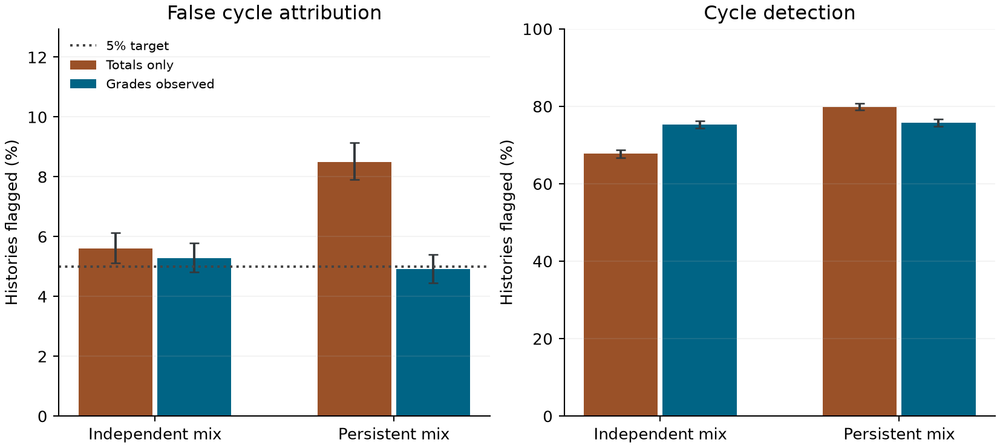

# Can changing borrower mix be mistaken for a persistent credit cycle?

## Protocol fixed before measuring rejection rates

Use 20-year histories of 1,000 equal exposures refreshed annually and LGD 45%. The low- and high-risk grades have unconditional one-year PDs of 0.5% and 3%. Both have Gaussian asset correlation 0.25. Before defaults occur, either 50 or 350 borrowers are in the higher-risk grade. The mix state has equal stationary probabilities and is independent of the Gaussian credit factor. The mean higher-risk share is 20%, and the mean borrower PD is 1%.

Cross annual factor persistence 0 or 0.6 with mix persistence 0 or 0.8. For the two-state mix process the probability of staying in the same state is (1 + persistence)/2, or 50% versus 90%. Both processes start in stationarity. Changing either transition leaves the one-year joint law of grade sizes and default counts fixed. This definition holds across these four scenarios. Heterogeneous grades change the portfolio from the preceding homogeneous experiment.

**Decision rules.** Both validators test zero credit-factor persistence against 0.6. Both know the grade PDs, possible starting mixes and their candidate dynamics. Give the two possible mix dynamics equal weight once per complete history in each hypothesis. For the totals-only validator, integrate out the hidden mix and credit factor in the likelihood. The grade-aware validator observes beginning-of-year grade sizes and defaults in each grade. Its observed mix-path likelihood cancels in the cycle likelihood ratio because composition is exogenous. Use the same underlying histories for the two tests.

**Primary endpoint.** Set both upper-tail log likelihood ratio cutoffs with 12,000 independent histories under neither process persistent, targeting 5% false attribution. Hold those cutoffs fixed. Measure false cycle attribution when only the mix persists, and report the paired difference (totals-only minus grade-aware). Also evaluate neither, cycle only and both. Use 8,000 fresh independent histories per scenario.

**Matched false-alarm comparison.** Calibrate each test at the same nominal 5% in a separate sample of 12,000 mix-only histories. Evaluate on independent mix-only and both-persistent histories. Compare with the analogous neither/cycle-only pair from the primary analysis. Report realized false alarms, detection rates, Wilson intervals and paired uncertainty for the differences. Report sensitivity of rates to calibration cutoffs. Seed 20261123. A positive test is evidence for credit-factor persistence within these candidate models. Detecting an actual persistent change in underwriting alone is a false cycle attribution for this question.

**Checks.** Verify the one-year count law by summing the two-grade emissions and cross-checking its probability generating function. Verify ordered likelihoods by direct summation of small discrete paths, grade aggregation, time reversal, and finer factor quadrature on held-out histories before interpreting results.

## Main result

When the borrower mix persisted but the credit environment reset each year, **680 of 8,000** histories triggered a credit-cycle flag using totals alone. Observing beginning-of-year grade sizes and grade-level defaults reduced this to **393 of the same 8,000**. The difference is **3.59 percentage points**, with a paired 95% Monte Carlo interval of **3.11 to 4.07 points** at the calibrated thresholds. There were 339 histories flagged only by the totals validator and 52 flagged only by the grade-aware validator.

| True source of persistence | Meaning of a cycle flag | Totals only | Grade sizes and grade defaults |
|---|---|---:|---:|
| Neither | False alarm | 5.60% | 5.28% |
| Borrower mix only | False cycle attribution | 8.50% | 4.91% |
| Credit environment only | Detection | 67.75% | 75.30% |
| Both | Detection | 79.88% | 75.79% |

These rules were calibrated on a separate sample where neither process persisted. The mix-only attribution rates have 95% Wilson intervals of **7.91–9.13%** for totals and **4.46–5.41%** for grades. Across a binomial order-statistic interval for the calibration cutoff, the corresponding rates varied from **7.79% to 8.89%** and **4.69% to 5.21%**. Rate intervals condition on the fitted cutoffs. This sensitivity check varies the cutoffs while holding the evaluation histories fixed. [Rejection counts, intervals and cutoff sensitivity](../results/borrower_mix_rates.csv) · [Paired comparisons](../results/borrower_mix_paired.csv)

## Detection at comparable false-alarm rates

Under the original cutoffs, totals alone flagged more histories when both processes persisted. That rule also flagged 8.50% when only the mix persisted. To compare power, first calibrate both rules on 12,000 *mix-only* histories. On independent mix-only histories the false-alarm rates were **4.79%** and **4.91%**. On both-persistent histories the detection rates were **68.95%** and **75.78%**, respectively. The paired gain from grade information was **6.83 points** (95% interval **6.05–7.60**).

For a supplementary comparison, choose a cutoff for each validator that flags exactly 400 of the 8,000 evaluation histories under the relevant null. Then measure detection on independently drawn alternative histories.

| Mix dynamics shared by null and alternative | False-alarm rate used to match | Cycle detection, totals | Cycle detection, grades |
|---|---:|---:|---:|
| Independent | 5.00% | 66.28% | 74.70% |
| Persistent | 5.00% | 69.81% | 76.15% |

The 5% in this table is fixed by construction on the matching sample. The preceding independently calibrated comparison gives the held-out false-alarm check. [Equal-size results](../results/borrower_mix_equal_size.csv)

## Interpretation

The totals-only test already allows for persistent borrower mix. Its difficulty is learning which process generated the history when it sees only the aggregate. Beginning-of-year grade counts reveal the mix path; defaults within each grade also tell the validator about the common credit environment. The experiment measures the combined value of those two pieces of information. It does not separately estimate their contributions.

The grades and their PDs are known, stable and exogenous to the credit cycle. Real grades can migrate with economic conditions, grade-level PD estimates can be noisy, and underwriting can respond to the cycle. Those features could change the value of the observed grades and the direction of attribution errors. The percentages here describe synthetic 20-year histories under the specified inputs. The earlier homogeneous portfolio's stressed ES gap belongs to a different portfolio and is not an estimated cost of this attribution error.

## How the experiment isolates the two mechanisms

Conditional on the common Gaussian factor $z$, a borrower in grade $g$ defaults with probability $u_g(z)=\Phi((\Phi^{-1}(p_g)-\sqrt{\rho}z)/\sqrt{1-\rho})$. Draw defaults in the two grades as conditionally independent binomials using their beginning-of-year sizes. Each year's portfolio starts with fresh borrower shocks. The stationary factor density and the two stationary mix probabilities are the same in all four scenarios. Thus their one-year loss distributions are identical, including tail quantiles, even though their sequences of losses can differ.

The expected default count is **6.25** in the low-share state and **13.75** in the high-share state, averaged over the credit factor. With an independent credit environment and persistent mix, adjacent counts have covariance $0.8(3.75)^2=11.25$ in squared defaults. Thus the changing book alone produces genuine serial association in total defaults. The inference question is what caused that association.

Let $L_{c,m}$ be a history's likelihood under cycle persistence $c$ and mix persistence $m$. The totals-only score is

$$
\log\frac{L_{0.6,0}+L_{0.6,0.8}}{L_{0,0}+L_{0,0.8}}.
$$

Each component sums over the unobserved grade-default allocation and integrates over the entire hidden cycle and mix paths. The equal candidate weights cancel from the ratio. Their choice defines a test of these specified alternatives. The weights are common to both validators.

The grade-aware input includes the actual mix path and both grade-default counts. Conditional on that path, grade-emission probabilities depend on the credit factor and the known grade sizes. The probability of the mix path under either mix law is the same in the numerator and denominator and factors out. This validator therefore filters only the credit state. Neither validator observes the credit factor or receives the label of the generating scenario.

## Numerical checks

The simulator draws continuous Gaussian factors independently of the likelihood grid. The filter integrates over 40 half-unit panels spanning −10 to 10. The aggregate observation law convolves the two conditional binomial distributions. Its mass sums to one and its mean reproduces 10 defaults. Its probability generating function agrees with a separate calculation that multiplies the grade-specific binomial generating functions before integration.

Tests enumerate a two-year small-book likelihood over both mix models, mix-state paths and pairs of factor nodes. They also check time reversal, the single-year likelihood identity, and identical one-year observations when the same starting draws are coupled across the four dynamics. When grade PDs are equal, both validators give the same cycle score. Changing only the grade breakdown while keeping totals fixed leaves the totals-only score unchanged.

The maximum change in an audited log likelihood ratio when doubling the quadrature order from 8 to 16 was below **0.00009**. The audit included a fixed set of histories and histories containing the most extreme total and grade counts in each evaluation scenario. Across the four samples, mean annual defaults ranged from 9.93 to 10.01. The equality of the one-year laws follows from the stationary construction. [Audit output](../results/borrower_mix_checks.csv)

Run `python experiments/borrower_mix.py` in the installed environment to regenerate all four result tables and the figure. [Reproduction instructions](../README.md#reproduce)
