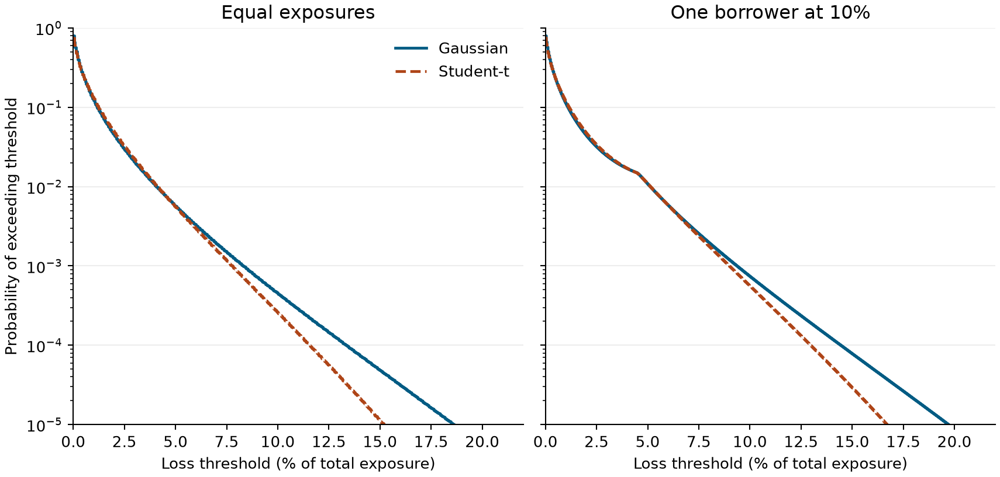
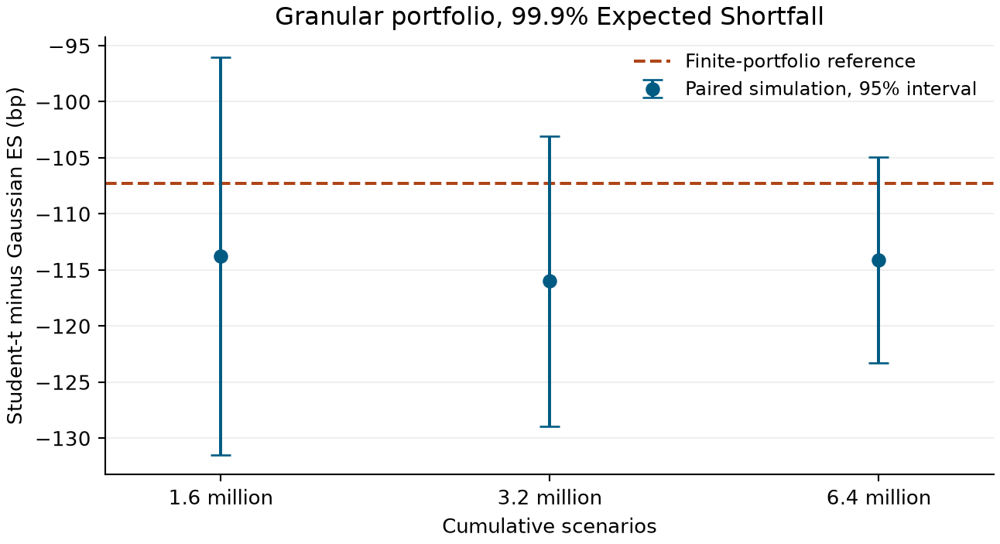

# Matched default probabilities in a finite portfolio

## Baseline results

One-year PD is 1% for every borrower, deterministic LGD is 45%, and expected portfolio loss is 45 bp. The granular allocation gives each borrower 0.1% of total EAD. The concentrated allocation gives one borrower 10% and divides the remaining 90% equally among the other 999. All losses in the table are **basis points of total EAD**. One basis point equals 0.01% of exposure.

| Allocation | Confidence | Gaussian VaR | Student‑t VaR | Gaussian ES | Student‑t ES | ES difference (t − Gaussian) |
|---|---:|---:|---:|---:|---:|---:|
| Granular | 99% | 409.50 | 414.00 | 587.49 | 567.99 | −19.51 |
| Granular | 99.9% | 832.50 | 778.50 | 1,048.25 | 940.98 | −107.27 |
| Concentrated | 99% | 510.81 | 514.86 | 691.51 | 678.74 | −12.76 |
| Concentrated | 99.9% | 936.49 | 900.00 | 1,154.59 | 1,071.77 | −82.83 |

At 99%, the Student‑t model gives slightly higher VaR and lower ES for both allocations. The ordering at a loss cutoff can differ from the ordering of the average losses beyond it. At 99.9%, both measures are lower under the calibrated Student‑t model. The granular illustrative capital proxy, 99.9% VaR minus EL, is **787.50 bp** for Gaussian and **733.50 bp** for Student‑t. [Full numerical results](../results/reference.csv)

## What the calibration holds fixed

The benchmark Gaussian latent correlation is 0.25. With ten degrees of freedom and one common scale draw per scenario, a Student‑t latent correlation of 0.039493 yields the same probability of two specified borrowers defaulting together, **0.043752%**. Every default indicator pair then has correlation **3.4092%** in both models. For fixed exposure weights and LGDs this determines portfolio variance. Loss standard deviation is **83.84 bp** in the granular portfolio and **94.49 bp** in the concentrated one.

The first unrestricted joint probability involves three borrowers. Given defaults by two specified borrowers, the probability of default by a third is **9.75%** under Gaussian and **8.70%** under Student‑t. This illustrates one difference in clustering. ES depends on the full joint law. The one-year PD stays fixed throughout this comparison, so an asymptotic copula tail-dependence coefficient alone cannot rank these portfolio losses. [Calibration and third-default probabilities](../results/calibration.csv) · [Model equations and feasibility checks](research_design.md)

## Numerical evidence

The reference calculation conditions on the common factors. The designated borrower contributes a Bernoulli loss and the other 999 contribute a conditionally independent binomial count. Integer exposure units combine coincident loss outcomes before computing VaR and ES. The Student calculation integrates the density of the probit-transformed conditional PD to reuse each conditional binomial distribution across scale values. Refining integration from order 16 to 32 changed every reported ES by less than **0.000001 bp** and preserved every VaR cutoff. This measures numerical stability under refinement. [Integration and moment checks](../results/quadrature_checks.csv)

A separate direct simulation uses the same Gaussian factor and borrower shocks across models. At **6.4 million** scenarios, the granular 99.9% ES difference is **−114.14 bp**, with a 95% paired-batch interval of **[−123.31, −104.96] bp**. It contains the reference value of −107.27 bp. The **9.18 bp** half-width exceeds the prespecified 2 bp precision target at the scenario budget. For this release we retired the 2 bp simulation target after the budgeted run. The simulation serves as an independent check on sign and magnitude. The reported central results use integration. The intervals measure simulation uncertainty conditional on the inputs. [Simulation results and intervals](../results/monte_carlo.csv)

## Frozen-parameter PD stress

Doubling marginal PD to 2% with both latent correlations frozen increases granular 99.9% ES to **15.20% of exposure** under Gaussian and **11.66%** under Student‑t. The corresponding pair-default probabilities become **0.13614%** and **0.11554%**. Consequently the stressed gap includes differences in pairwise dependence as well as higher-order clustering. The PD change is an illustrative scenario assumption. [Stress outputs](../results/reference.csv)
