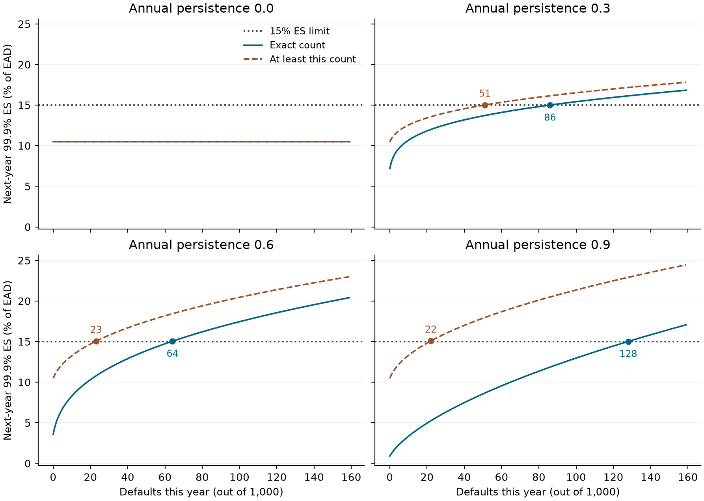

# How many defaults trigger a 15% Expected Shortfall limit?

## Protocol fixed before computing the triggers

Use the existing stationary Gaussian credit-factor model with 1,000 equal exposures, one-year PD 1%, asset correlation 0.25 and fixed LGD 45%. Reset portfolio composition each year. Consider annual persistence 0, 0.3, 0.6 and 0.9. All forecasts start from the stationary prior before observing the completed year's count. The primary case is persistence 0.6. The illustrative risk limit is next-year 99.9% ES at or above 15% of total exposure.

Let $K$ be this year's count and $L'$ next year's loss. Find two integer triggers starting at zero, including equality at the ES limit.

- The **exact-count trigger** $e$ is the smallest $k$ for which ES conditional on $K=k$ reaches the limit.
- The **alert trigger** $a$ is the smallest $k$ for which ES conditional on $K\ge k$ reaches the limit. At forecast time the committee receives a single yes/no alert with a fixed threshold. The conditional loss distribution pools all qualifying counts before ES is calculated.

Report annual trigger frequencies $P(K\ge e)$ and $P(K\ge a)$, the fraction of years with an alert and an exact-count forecast below the limit, and the fraction of alerts with that disagreement. Display the conditional probability of a realized loss **strictly greater than 15%** at the exact boundary $K=e$ and given the alert $K\ge a$. With equal exposures this requires at least 334 defaults next year. When a trigger does not exist, its annual frequency is zero and its conditional probability is undefined.

Compute forecasts by deterministic integration using the existing finite-portfolio model. Check the integer before and at each crossing, reproduce the earlier count-43 forecasts, check the independent-year benchmark, and test stability under quadrature refinement. Independently cross-check next-year exceedance probabilities by integrating the conditional binomial survival function. The model probabilities describe a randomly chosen stationary year. Persistent environments can produce runs of alerts.

## Decision table

At annual persistence **0.6**, next-year 99.9% ES crosses 15% of total exposure at **64 observed defaults**, or when a committee receives only the alert **“23 or more defaults.”** If the actual count is 23, the exact-count forecast is **10.78%**. The alert forecast is **15.05%** because it also covers years with much more than 23 defaults.

| Persistence | Exact trigger | Alert trigger | Years reaching exact trigger | Years with alert | Alerts with exact ES below limit | Realized loss >15% given exact boundary | Realized loss >15% given alert |
|---:|---:|---:|---:|---:|---:|---:|---:|
| 0.0 | None | None | 0% | 0% | — | — | — |
| 0.3 | 86 | 51 | 1.156% | 3.583% | 67.73% | 0.03709% | 0.03716% |
| 0.6 | 64 | 23 | 2.280% | 12.114% | 81.18% | 0.03790% | 0.03769% |
| 0.9 | 128 | 22 | 0.378% | 12.791% | 97.05% | 0.03794% | 0.03795% |

The two frequency columns both refer to meeting or exceeding the count shown. The final two columns condition on different observations. For persistence 0.6 they use $K=64$ and $K\ge23$, respectively. Under independent annual factors next-year ES stays at 10.48% for every current count, so there is no triggering event to condition on. [Full precision decision table](../results/reverse_stress_decisions.csv)

## What the committee learns

**How often do the decisions differ?** With persistence 0.6, the exact-count forecast is below the limit for counts 23 through 63, inclusive, while the binary alert has fired. Those counts account for **9.83% of all years**, or **81.18% of alert years**. Counts of 64 or more account for the remaining 18.82% of alerts. Both forecasts use the same model. The alert combines several levels of severity into a single message. The disagreement measures the consequence of that information loss.

**What happens at the boundary?** Going from exactly 63 to exactly 64 defaults raises ES from **14.969%** to **15.047%**. For a binary report, changing its threshold from “at least 22” to “at least 23” raises the ES conditional on receiving that report from **14.936%** to **15.051%**. The latter comparison concerns two possible reporting rules. Each committee receives only the one alert fixed in advance. Seeing which of many nested alerts fired could reveal the count itself.

**What does the limit say about actual losses?** Following the 23-or-more alert, the probability that next year's realized loss exceeds 15% is **0.03769%**, about 3.8 per 10,000 such forecasts. Expected Shortfall averages the worst 0.1% of losses; some losses in that tail can fall below 15% while others are large enough to bring its average above 15%. The 15% ES limit is an illustrative decision threshold, and these are synthetic conditional probabilities.

**Why does the exact trigger rise to 128 at high persistence?** An exact count narrows the range of plausible current factor values. At persistence 0.9 the next innovation is relatively small, so that information also narrows the extreme tail of next year's forecast. A more severe exact count is needed to cross the ES limit than in the 0.6 case. A binary report leaves the upper end of today's count open, including very adverse states that can carry into next year. [Earlier experiment on forecast revisions](persistence_design.md)

## Why the thresholds are well defined

A higher observed count favors a more adverse factor value. In particular, the ratio of binomial likelihoods for consecutive counts is proportional to $u(z)/(1-u(z))$, which increases as the factor becomes more adverse. For positive persistence, the transition carries this posterior ordering into the following year. Next-year count and loss rise in stochastic order, so exact-count ES is nondecreasing in the observed count. Pooling all counts at or above an alert threshold gives a next-year distribution at least as severe as the exact distribution at that threshold. This also makes alert ES nondecreasing in its threshold. Consequently $a\le e$ when both exist, and the disagreement probability is $P(a\le K<e)$. Compute alert ES from the pooled predictive distribution, since averaging the individual ES estimates would give a different statistic.

## Checks and reproduction

The deterministic integration used orders 16 and 32 on 48 factor panels. Both resolutions gave the same crossing decisions at every evaluated count. All ES changes were below 0.1 bp. The 43-default forecasts reproduced the earlier persistence experiment. A second calculation integrated the probability of at least 334 future defaults directly, conditioning backward from next year's Gaussian factor to this year's report. This checked all six realized-loss probabilities in the decision table independently of summing the forward loss distributions.

Run `python experiments/reverse_stress.py` in the installed project environment. The decision CSV records fractions, so a value of 0.00037694 represents 0.037694%. The curve CSV also supplies the probability of the exact count or alert and the full-precision ES on either side of each boundary. [Forecast curves](../results/reverse_stress_curves.csv) · [Reproduction instructions](../README.md#reproduce)
