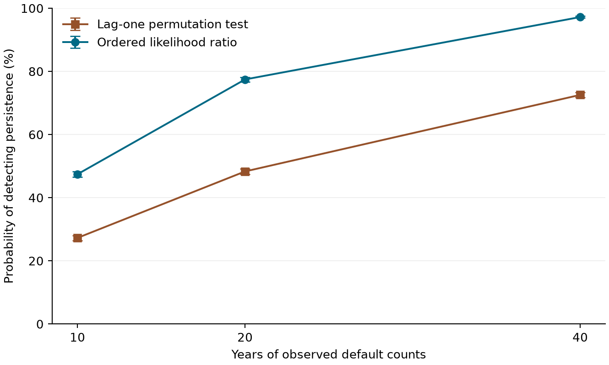

# Can a validator detect missing credit-cycle persistence?

## Protocol set before the power calculation

The null model redraws the common Gaussian factor independently each year. The alternative has stationary annual persistence 0.6. Both retain 1,000 equal exposures each year, a 1% marginal PD, asset correlation 0.25, and LGD 45%. Use the stationary prior at the start of each history. The validator observes only annual default counts. All structural parameters are given. The earlier experiment found a 645.56 bp difference in next-year 99.9% ES after a year with at least 43 defaults. This study asks how frequently a validator detects the dependence responsible for that conditional forecast difference. [Forecast experiment](persistence_design.md)

- **Primary comparison.** Use the ordered counts in 20 years. Compare 10- and 40-year prefixes from the same simulated histories. Include ordinary years and histories without a stress year.
- **Practical test.** Use the sum of products of successive counts centered at their history's sample mean. For a fixed set of counts, the denominator of the ordinary lag-one autocorrelation is constant across reorderings. Draw 199 independent uniform permutations per history. Reject for unusually positive association if the one-sided permutation p-value, counting ties and adding the observed ordering, is at most 5%.
- **Likelihood benchmark.** Use the log ratio of the ordered count likelihoods under persistence 0.6 and zero. Integrate out every unobserved factor and normalize the forward filter annually. Set a separate one-sided 5% cutoff for each history length using 40,000 calibration histories generated under the null. Use the order statistic at rank ceil(0.95 × 40,001) and reject strictly above it. The exact likelihood-ratio test maximizes power for these two fully specified models at a given size.
- **Evaluation.** Generate 12,000 fresh histories under each model. Apply both tests to each history. Report false alarms under the null, detection and missed detection under the alternative, 95% Wilson intervals for the rates, and the paired difference in detection rates. Intervals for likelihood-test rates condition on the calibrated cutoff. Also vary the cutoff across its binomial order-statistic uncertainty interval. The histories are independent within a model and the calibration, evaluation and permutation random streams are distinct.
- **Numerical checks.** Compare the forward likelihood with the independent-year identity, time-reversal symmetry and a two-year integrated probability. Check the log ratios on held-out paths against finer quadrature. Validate the permutation implementation with exhaustively enumerated short histories. Use fixed seed 20261122.
- **Scope.** Persistence, PD and asset correlation are fixed in this experiment. Estimating parameters, selecting models from a larger family and searching for reverse stress scenarios are separate research questions.

## What each test observes

For counts $k_1,\ldots,k_T$, the practical statistic is $\sum_{t=2}^T(k_{t-1}-\bar k)(k_t-\bar k)$. Reordering the years holds the entire empirical count distribution fixed and destroys its original ordering. Under independent years every ordering is equally probable conditional on the observed counts. Repeated counts can tie. A constant count history has p-value one. A permutation test uses no calibrated PD or asset correlation.

For the likelihood benchmark, write $b_k(z)$ for the binomial probability of observing $k$ defaults given factor $z$. Let $a_t(z)$ be the predictive factor density under persistence, using only counts before year $t$. The likelihood contribution for year $t$ is $m_t=\int a_t(z)b_{k_t}(z)\,dz$. Update the latent density to $a_t(z)b_{k_t}(z)/m_t$, then propagate it through the Gaussian transition to obtain $a_{t+1}$. Under independent years every predictive density is the stationary standard normal. Writing $m_0(k)$ for the stationary count probability, the benchmark score is $\sum_t\log[m_t/m_0(k_t)]$. A large positive score supports the persistent model. Both models assign the same likelihood to the first count; subsequent counts can carry evidence through their conditional distribution.

The 5% false-alarm target controls how often a test rejects independent years when they actually are independent. Power is the fraction rejected when persistence is 0.6. Its complement is the missed-detection rate. Failure to reject leaves both explanations in play. The 645.56 bp economic figure refers specifically to next-year ES following the stress trigger. It is neither an average error across all years nor a realized portfolio loss.

For historical context, Lopez and Saidenberg discuss why the limited number of independent forecasting periods complicates validation of annual credit portfolio models. [Federal Reserve Bank of San Francisco working paper](https://www.frbsf.org/economic-research/wp-content/uploads/sites/4/wp99-06.pdf)

## Results

At 20 years, the practical test detected persistence in 5,797 of 12,000 histories. The ordered likelihood test detected it in 9,293 of the same histories. Their missed-detection rates were **51.69%** and **22.56%**. The portfolio and model parameters in every one of those alternative histories imply the same conditional stress forecast difference. Whether a history supplies enough evidence to flag the model varies across samples.

| Years | Practical false alarms | Likelihood false alarms | Practical detection (95% interval) | Likelihood detection (95% interval) |
|---:|---:|---:|---:|---:|
| 10 | 5.29% | 5.33% | 27.26% (26.47–28.06%) | 47.43% (46.53–48.32%) |
| 20 | 5.03% | 5.60% | 48.31% (47.41–49.20%) | 77.44% (76.69–78.18%) |
| 40 | 5.06% | 5.34% | 72.55% (71.74–73.34%) | 97.20% (96.89–97.48%) |

The 20-year likelihood test detected persistence **29.13 percentage points** more often. A paired 95% interval for that difference is **28.21 to 30.05 points** at the prespecified rules. Its observed 5.60% false-alarm rate has a 95% Wilson interval of **5.20% to 6.03%** conditional on the simulated cutoff. The corresponding practical-test interval is **4.66% to 5.44%**. Varying the likelihood cutoff over its calibration uncertainty interval moved its 20-year detection rate between **76.73% and 78.16%**. [All test outcomes and intervals](../results/validation_power.csv) · [Calibration and paired comparisons](../results/validation_diagnostics.csv)

As a supplementary check prompted by the 20-year false-alarm difference, we reset the likelihood cutoff to match the permutation test's 604 false alarms on the 12,000 null evaluation histories. Applied to the independent alternative histories, likelihood detection was **76.18%**, against **48.31%** for the permutation test. Matching the observed false-alarm counts removes that discrepancy from the comparison. The matched 5.03% is an in-sample calibration statistic for this supplementary threshold; the table retains the original independently evaluated thresholds.

## Implications for validation

A validator using adjacent-year association alone would often keep the independent-year model after 20 years, even with an economically substantial error in its stressed ES forecast. The likelihood benchmark shows how much additional evidence these same histories can supply when the borrower count model, PD, asset correlation and persistence alternative are all specified correctly. Even under those favorable conditions, it missed more than half of the 10-year histories. At 40 years, it missed 2.80%. A rejection is evidence against the specified independent-year model. Other mechanisms, including changing portfolio composition or PD drift, could produce serial dependence in real portfolios.

These rates summarize repeated synthetic histories under two explicit models. They cannot establish the persistence of an actual portfolio, assign a probability that a particular non-rejected model is wrong, or supply a confidence interval for a bank's capital. The study measures detectability of a known misspecification; the earlier study supplies its economic magnitude.

## Numerical audit and reproduction

The forward filter uses composite Gauss–Legendre quadrature with order 8 on 48 panels over the standard normal factor range from −12 to 12. Repeating the calculation at order 16 on 256 evaluation histories from each model, plus a history containing the largest observed count from each set, changed no audited log ratio by more than 0.00020. Tests independently check the single-borrower two-year joint probability, normalization of a small portfolio's complete three-year count law, reversibility, the independent-year likelihood identity, and tied permutation statistics.

Run `python experiments/validation_power.py` in the installed project environment to regenerate both CSV files and the figure. The simulator draws the continuous latent factor directly, independently of the likelihood quadrature. The same history prefixes are used across horizons, so results at 10, 20 and 40 years are correlated. The plotted intervals describe simulation uncertainty in the individual rejection rates. [Reproduction instructions](../README.md#reproduce)
